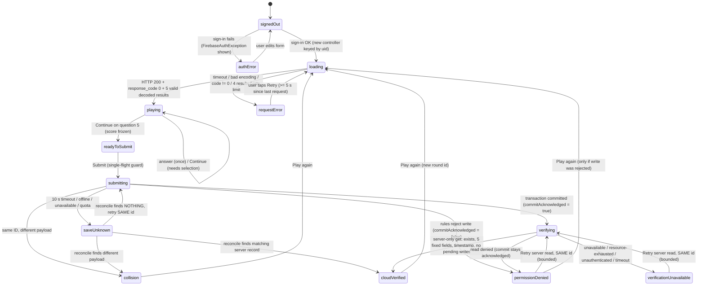

# State machine (names match `QuizPhase` in `lib/state/quiz_controller.dart`)

Guards: replay + sign-out are disabled while `unresolved`
(`submitting`, `verifying`, `saveUnknown`, `verificationUnavailable`, and `permissionDenied` after a real commit).
Every async callback checks `_isCurrent(roundId)` (same UID + same round, controller not disposed) before touching state.

Render in VS Code with the "Markdown Preview Mermaid Support" extension, or paste into https://mermaid.live
and export PNG for your evidence document. (Add your own variable names if you rename anything.)
